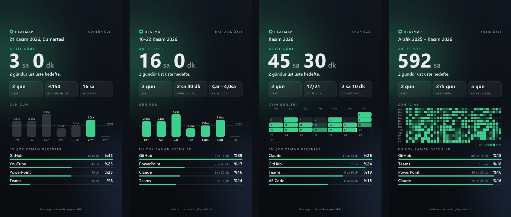

# Heatmap

[](https://github.com/Mswindler-Mert/Heatmap/actions/workflows/testler.yml)

Windows'ta arka planda çalışıp **bilgisayar başında aktif geçen çalışma sürenizi kendiliğinden ölçen**,
bu sürenin hangi uygulama ve sitelerden geldiğini gösteren ve paylaşılabilir bir özet kartına çeviren yerel bir uygulama.
Kronometre değildir: başlat/durdur düğmesine basmazsınız. Uygulama öndeki pencereye, tarayıcı
sekmesinin başlığına ve klavye/fare hareketine bakar; sayacı kendisi başlatır ve durdurur.



<sub>Paylaşım kartları (1080×1920, Instagram hikâyesi boyutu). Görseldeki veriler örnektir;
`docs/ornek_gorsel_uret.py` ile yeniden üretilebilir.</sub>

- **Tamamen yerel:** hiçbir veri bilgisayarınızdan çıkmaz, hesap ya da internet gerekmez.
- **Takılıp çıkarılabilir modüller:** her tespit kaynağı ayrı bir dosyadır ve ayardan kapatılabilir.
- **Öğrenir:** karar veremediği oturumları siz işaretlersiniz, bir dahaki sefere kendisi tanır.
- **Paylaşım kartı:** günlük/haftalık özeti hikâye boyutunda bir görsele çevirir; kartta pencere
  başlıkları yer almaz, yalnızca uygulama ve site adları görünür.
- **JSON API:** veriyi başka araçlardan (masaüstü dashboard'u, sağlık verisi birleştirme) okuyabilirsiniz.

## Nasıl çalışır?

```
 Dedektörler (saniyede bir okunur)
 ┌──────────────┐ ┌──────────────┐ ┌──────────┐ ┌──────────────────┐
 │ Aktif pencere│ │ Sekme başlığı│ │ Boşta    │ │ Kamera           │
 │ / süreç      │ │ / YouTube    │ │ kalma    │ │ (iskelet, kapalı)│
 └──────┬───────┘ └──────┬───────┘ └────┬─────┘ └────────┬─────────┘
        └────────────────┴── sinyaller ─┴────────────────┘
                              ▼
                      ┌───────────────┐
                      │  Karar motoru │  birleştir + tolerans süreleri
                      └───────┬───────┘
                              ▼
                      ┌───────────────┐      ┌─────────────────────────┐
                      │ SQLite        │◄────►│ FastAPI: JSON API +     │
                      │ (oturumlar)   │      │ koyu temalı web arayüzü │
                      └───────────────┘      └─────────────────────────┘
```

Her dedektör `ders`, `ders_degil`, `belirsiz` ya da `fikrim_yok` diyen bir sinyal üretir.
Karar motoru bunları şu kurallarla birleştirir:

| Durum | Sonuç |
|---|---|
| Önde ders uygulaması var (VS Code, PDF okuyucu…) | Sayaç çalışır |
| Önde ders dışı uygulama var (Steam, Discord…) | Sayaç durur |
| Önde tarayıcı var | Karar sekme başlığındaki anahtar kelimelere göre verilir |
| Başlıkta tanıdık kelime yok ya da çelişki var | **Belirsiz**: sayılmaz, sonradan düzeltilebilir |
| Klavye/fare uzun süredir kullanılmıyor | Sayaç durur |
| …ama video izleniyor | Durmaz (video için ayrı, daha uzun bir eşik vardır) |

**Tolerans:** anlık değişiklikler sayacı hemen etkilemez. Varsayılan ayarlarla dersten 15 saniyeden
kısa ayrılmalar yok sayılır; sayacın başlaması için 5 saniye kesintisiz ders durumu gerekir.

## Kurulum

Gerekenler: Windows 10/11 ve [Python](https://www.python.org/downloads/) 3.11 veya üstü.

```bat
git clone https://github.com/Mswindler-Mert/Heatmap.git
cd Heatmap
baslat.bat
```

`baslat.bat` dosyasına çift tıklamak da yeterlidir. İlk çalıştırmada sanal ortamı (`.venv`) kurar
ve paketleri yükler; sonraki açılışlarda doğrudan başlatır.

### Python kurmadan (.exe)

GitHub'daki **Releases** bölümünde `Heatmap.exe` varsa onu indirip boş bir klasöre koy ve çift tıkla;
Python kurmak gerekmez. Ayar ve veriler `.exe`'nin yanındaki `config/` ve `data/` klasörlerinde
oluşur. `.exe` imzasız olduğu için Windows ilk açılışta "Windows kişisel bilgisayarınızı korudu"
uyarısı gösterebilir: **Ek bilgi** > **Yine de çalıştır**. Kamera modülü `.exe` sürümünde ayrı bir
Python ortamı ister ([kamera_isci/README.md](kamera_isci/README.md)).

`.exe`'yi kendin derlemek için:

```bat
.venv\Scripts\python -m pip install -r requirements-build.txt
.venv\Scripts\python paketle.py
```

Sonuç `dist\Heatmap.exe` olur. GitHub'da `v` ile başlayan bir etiket gönderince
(`git tag v0.4.0`, `git push origin v0.4.0`) aynı derleme otomatik yapılır ve `.exe` o sürüme eklenir.

## Kullanım

- Uygulama açılınca saatin yanında (sistem tepsisinde) bir ikon belirir ve tarayıcıda arayüz açılır:
  <http://127.0.0.1:8765>
- İkon rengi: **yeşil** = sayaç çalışıyor, **sarı** = belirsiz, **gri** = sayaç durdu.
- İkona sağ tıklayınca: arayüzü aç, takibi duraklat, ayar dosyasını aç, Windows açılışında başlat, çıkış.
- **Windows açılışında başlat:** arayüzün sağ üstündeki kutudan ya da tepsi menüsünden açılır.
  Açıkken bilgisayarı her açtığında Heatmap tarayıcı açmadan arka planda başlar, böylece takibi
  başlatmayı unuttuğun günler kaybolmaz. Ayar, kullanıcı hesabının kayıt defterine (`Run` anahtarı)
  yazılır ve Görev Yöneticisi > Başlangıç uygulamaları altında da görünür.

Arayüzde şu bölümler vardır:

1. **Şu an:** bugünkü toplam süre, sayacın durumu, algılanan uygulama ve her modülün sinyali.
2. **Bu hafta:** gün gün çalışma süresi. Altındaki **Adım / egzersiz / uyku ekle** bölümünden günlük
   sağlık verisini elle girebilirsin; girilen değerler günlerin altında görünür. (Telefondan otomatik
   aktarma için plan: SONRAKI_ADIMLAR.md 4.2. Bu veri paylaşım kartına ve dashboard'a girmez.)
3. **Son 12 ay (ısı haritası):** GitHub katkı grafiği gibi her gün bir kare; ne kadar uzun
   çalıştıysan o kadar koyu yeşil, günlük hedefi tutan günler en koyu. Altında seri ve en uzun seri.
4. **Süre nereden geldi?:** bugünkü ya da bu haftaki sürenin uygulamalara ve sitelere ya da
   kategorilere (Kod, Yapay zekâ, Belge ve not, Video ve kurs, İletişim) dağılımı.
5. **Paylaşım kartı:** günlük, haftalık, aylık (takvim) ya da yıllık (son 12 ay ısı haritası) özeti
   1080×1920 PNG olarak üretir ve indirir. Tarih seçerek geçmiş bir günün/ayın kartı da alınabilir.
   İçerik, Instagram hikâyesinin üst ve alt düğmelerinin örtmediği orta alana yerleştirilir.
6. **Oturumlar:** üstte seçili günün saat saat renkli şeridi (zaman çizelgesi), altında kayıtlı zaman dilimleri. Her birini “Çalışmaydı” / “Çalışma değildi” diye düzeltebilir,
   düzeltmeyi **Geri al** ile kaldırabilirsiniz. 1 dakikadan kısa oturumlar varsayılan olarak gizlenir.
   “Bundan sonra da böyle say” seçiliyse aynı uygulama ya da başlık artık otomatik tanınır.
   Tarayıcı oturumlarında isterseniz bir anahtar kelime (örn. kanal adı) de öğretebilirsiniz.
7. **Karar bekleyenler:** bütün günlerde hâlâ belirsiz olan başlık ve uygulamalar, toplam süreye göre;
   tek tıkla o başlığın bütün oturumlarına karar ver. Yanında öğrenen tahminin önerisi görünür.
8. **Öğrenilen kurallar:** düzeltmelerden oluşan kurallar; buradan silinebilir.

## Tarayıcı eklentisi (önerilir)

`eklenti/` klasöründeki küçük Brave/Chrome eklentisi, Heatmap'e öndeki sekmenin **site adını** ve
**ses çalıp çalmadığını** bildirir. Böylece siteler başlıktan tahmin edilmek yerine doğru tanınır
(`claude.ai`, `geeksforgeeks.org`...) ve duraklatılmış bir video artık izleniyor sayılmaz.
Adresin tamamı, başlık ya da sayfa içeriği gönderilmez. Kurulum: [eklenti/README.md](eklenti/README.md).

## Masaüstü dashboard'u

<http://127.0.0.1:8765/dashboard> adresi, masaüstü arka planında durması için tasarlanmış sade bir
panel gösterir: bugünkü süre ve hedef çubuğu, sayacın durumu, bu haftanın çubukları, son 20 haftanın
ısı haritası ve bugün en çok kullanılan üç uygulama/site. Pencere ya da sekme başlığı göstermez;
ekran paylaşımında görünse bile yalnızca uygulama/site adları ve süreler görünür.

Duvar kâğıdı yapmak için web sayfasını arka plan olarak gösterebilen bir araç gerekir, örneğin
Microsoft Store'daki ücretsiz **Lively Wallpaper**: yeni duvar kâğıdı eklerken adres olarak
`http://127.0.0.1:8765/dashboard` yaz. Panel sağda durur, sol taraf masaüstü simgelerine kalır.
Zemini saydam istersen adresin sonuna `?saydam=1` ekle.

## Kamera modülü (isteğe bağlı, deneysel)

Kamera açıkken Heatmap, masada olup olmadığını anlar: kitap okurken ya da video izlerken klavyeye
dokunmasan da sayaç durmaz; masadan kalkınca durur; kafan uzun süre aşağıdaysa (not mu alıyorsun,
telefona mı bakıyorsun?) o süreyi "belirsiz" yapıp karar vermeyi sana bırakır. **Görüntü hiçbir
zaman kaydedilmez ya da gönderilmez.** Kamera analizi ayrı bir süreçte, kendi Python ortamında
çalışır. Kurulum ve kalibrasyon: [kamera_isci/README.md](kamera_isci/README.md).

> Ana uygulama tarafı test edildi; gerçek kamera + MediaPipe kısmı henüz gerçek bir kamerayla denenmedi.

## Ayarlar

İlk açılışta `config/config.ornek.toml` dosyası `config/config.toml` adıyla kopyalanır.

En kolayı arayüzün en altındaki **Ayarlar** bölümü: günlük hedef, süreler, uygulama ve site
listeleri, kart yazısı gibi ayarları oradan değiştirip **Ayarları kaydet**'e bas. Değişiklik
yeniden başlatmadan uygulanır; `config.toml`'daki yorumların korunur ve eski hâlinin kopyası
`data/yedek/` içine konur. Port, okunabilir adlar, siteler ve kategoriler gibi diğer ayarlar için
dosyayı elle düzenle (tepsi menüsünde "Ayar dosyasını aç") ve Heatmap'i yeniden başlat.

| Bölüm | Ne ayarlanır |
|---|---|
| `[tolerans]` | Sayacın başlama ve durma tolerans süreleri |
| `[pencere]` | Ders / ders dışı / tarayıcı süreç adları, bilinmeyen uygulamaların hükmü |
| `[baslik]` | Çalışma / çalışma dışı anahtar kelimeler ve siteler (`ders_alanlari`), video işaretleri, sayacı hiç etkilemeyen sekmeler |
| `[bosta]` | Boşta kalma eşiği ve video izlerken geçerli eşik |
| `[adlar]` | Süreç adı → dökümde görünen ad (`"Code.exe" = "VS Code"`) |
| `[siteler]` | Site adı → sekme başlığında aranan kelimeler ve alan adları; tanınmayanlar "Diğer web" olur |
| `[tarayici]` | Tarayıcı eklentisi modülü |
| `[kategoriler]` | Kategori adı → içindeki uygulama/site adları (dökümde gruplama için) |
| `[hedef]` | Günlük hedef (dakika); seri hesabında kullanılır |
| `[tahmin]` | Öğrenen tahmin: öneriler, otomatik karar (varsayılan kapalı), güven eşiği |
| `[kart]` | Paylaşım kartının sol üstündeki yazı (`ust_metin`) |
| `[yedek]` | Günlük otomatik yedek ve kaç gün saklanacağı |
| `[kamera]` | Kamera modülü: eşik süreleri, kalibrasyon, kamerasız deneme senaryosu |

Her modül `etkin = false` ile kapatılabilir.

## JSON API

Sunucu yalnızca `127.0.0.1` üzerinde dinler. Etkileşimli dokümantasyon:
<http://127.0.0.1:8765/api/docs>

| Uç | Açıklama |
|---|---|
| `GET /api/surum` | Çalışan sürüm |
| `GET /api/ayarlar` · `POST /api/ayarlar` (`{"degisiklikler": {"hedef.gunluk_dk": 90}}`) | Düzenlenebilir ayarlar; kaydet ve yeniden başlatmadan uygula |
| `GET /api/durum` | Şu an algılanan durum, sayaç, bugünkü toplam |
| `GET /api/ozet/bugun` | Bugünkü ders süresi |
| `GET /api/ozet/hafta` | Bu haftanın gün gün süreleri |
| `GET /api/gunluk?baslangic=2026-11-01&bitis=2026-11-30` | Tarih aralığı için gün gün çalışma süresi + sağlık verisi (adım, egzersiz, uyku; yoksa `null`) |
| `GET /api/saglik` · `POST /api/saglik` · `DELETE /api/saglik/{tarih}` | Günlük sağlık verisi (`{"tarih": "2026-11-21", "adim": 8200, "egzersiz_dk": 30, "uyku_dk": 450}`; boş alan değişmez) |
| `GET /api/kamera` · `POST /api/kamera` (`{"acik": false}`) · `POST /api/kamera/kalibre` | Kamera durumu, geçici aç/kapat, kalibrasyon |
| `GET /api/dokum?baslangic=2026-11-16&bitis=2026-11-22&gruplama=kategori` | Sürenin uygulamalara/sitelere ya da kategorilere dağılımı (tarih verilmezse bugün) |
| `GET /api/seri` | Günlük hedef ve üst üste hedefe ulaşılan gün sayısı |
| `GET /api/isi-haritasi?bitis=2026-11-21&hafta=53` | Isı haritası: her gün için süre ve 0-4 seviye, seri istatistikleri |
| `GET /api/otomatik-baslatma` · `POST` (`{"acik": true}`) | Windows açılışında başlatma durumu |
| `GET /api/kart?tur=gunluk&tarih=2026-11-21&liste=kategori` | Paylaşım kartı (PNG); `tur`: `gunluk`, `haftalik`, `aylik`, `yillik`; `liste`: `uygulama`, `kategori`, `yok`; `indir=true` dosya olarak indirir |
| `GET /api/zaman-cizelgesi?tarih=2026-11-16` | Günün şeridi: parçalar (günün başından dakika), hüküm, okunabilir ad; başlık içermez |
| `GET /api/karar-bekleyenler` · `POST` (`{"tur": "baslik", "deger": "...", "hukum": "ders"}`) | Bütün günlerdeki belirsizler ve toplu karar |
| `GET /api/tahmin` | Öğrenen modelin durumu (örnek sayısı, doğruluk, kapsam) |
| `GET /api/oturumlar?tarih=2026-11-16` | Bir günün oturumları |
| `POST /api/oturumlar/{id}/duzelt` | Oturumu düzelt (`{"hukum": "ders", "ogren": true, "kelime": null}`) |
| `GET /api/kurallar` · `DELETE /api/kurallar/{id}` | Öğrenilen kurallar |
| `POST /api/duraklat` | Takibi duraklat / sürdür (`{"duraklat": true}`) |
| `GET /api/disa-aktar/gunluk.csv` · `GET /api/disa-aktar/oturumlar.csv` | Excel için CSV (varsayılan son 365 gün; `baslangic`, `bitis`; oturumlarda başlıklar yalnızca `basliklar=true` ile) |
| `GET /api/dashboard` | Masaüstü dashboard'unun tek seferlik özeti (pencere başlığı içermez) |
| `POST /api/tarayici` | Tarayıcı eklentisinin raporu (`{"alan_adi": "youtube.com", "sesli": true, "odakta": true}`) |

Veri değiştiren istekler (`POST`, `DELETE`) `X-Heatmap: 1` başlığı taşımalıdır; yoksa `403` döner.
Bu, açık bir web sitesinin tarayıcın üzerinden bu API'ye gizlice istek göndermesini engeller.

Süreler saniye cinsindendir (`ders_sn`).

## Gizlilik

- Web sunucusu yalnızca bu bilgisayardan erişilebilir; uygulama internete hiçbir şey göndermez.
- Tarayıcı eklentisi yalnızca site adını (`youtube.com`) ve ses durumunu, yalnızca bu bilgisayardaki
  Heatmap'e gönderir; adresin tamamı ve sayfa içeriği gönderilmez.
- Pencere başlıkları ve uygulama adları yalnızca `data/heatmap.db` dosyasında saklanır.
- `data/` klasörü ve `config/config.toml` `.gitignore` içindedir; depoya girmez.
- Kamera modülü görüntüyü kaydetmez ve göndermez; kare analizden hemen sonra silinir ve ana
  uygulamaya yalnızca "yüz var / yok, kafa açısı" gibi sonuçlar gider. Bir test, kamera işçisinin
  kodunda kare kaydetme ya da ağ kodu bulunmadığını her çalıştırmada denetler.

## Dışa aktarma

Arayüzün en altındaki bağlantılarla son 365 günün verisini Excel'de açılan CSV dosyası olarak
indirebilirsin: **günlük özet** (gün gün çalışma dakikası, adım, egzersiz, uyku) ve **oturumlar**
(her oturum bir satır). Oturum dosyasında pencere başlıkları varsayılan olarak yer almaz.

## Yedek

Heatmap her gün veritabanının bir kopyasını `data/yedek/heatmap-YYYY-AA-GG.db` olarak alır ve son
7 günü saklar (`[yedek]` ayarı). Bir şey ters giderse: Heatmap'i kapat, `data/heatmap.db` dosyasını
başka bir adla sakla, istediğin yedeği `data/heatmap.db` adıyla kopyala ve Heatmap'i yeniden aç.

## Proje yapısı

```
Heatmap/
├── baslat.bat                # çift tıkla başlat
├── paketle.py                # tek dosya Heatmap.exe derler (PyInstaller)
├── config/config.ornek.toml  # varsayılan ayarlar (kişisel kopya: config.toml)
├── data/                     # veritabanı ve günlük dosyası (git dışı)
├── eklenti/                  # Brave/Chrome eklentisi (site adı + ses durumu)
├── kamera_isci/              # kamera analizi (ayrı süreç; MediaPipe)
├── heatmap/
│   ├── main.py               # parçaları kurar ve başlatır
│   ├── ayarlar.py            # ayar dosyasını okur
│   ├── sinyal.py             # Sinyal ve Dedektor: modüllerin ortak dili
│   ├── windows_api.py        # aktif pencere ve boşta süresini Windows'tan okur
│   ├── dedektorler/          # pencere.py, tarayici.py, baslik.py, bosta.py, kamera.py
│   ├── motor.py              # karar motoru
│   ├── takipci.py            # saniyelik takip döngüsü
│   ├── depo.py               # SQLite
│   ├── ozet.py               # okunabilir adlar, site ayırma, seri hesabı
│   ├── kart.py               # paylaşım kartı (PNG) çizimi
│   ├── yedek.py              # günlük veritabanı yedeği
│   ├── tepsi.py              # sistem tepsisi ikonu
│   └── web/                  # api.py + static/ (HTML, CSS, JS)
└── tests/                    # motor, sınıflandırıcı ve uçtan uca testler
```

Kodu okumaya `sinyal.py` → `dedektorler/` → `motor.py` → `takipci.py` sırasıyla başlamak en kolayıdır.

## Geliştirme

```bat
.venv\Scripts\python -m pip install -r requirements-dev.txt
.venv\Scripts\python -m unittest -v
.venv\Scripts\python -m heatmap --tepsisiz
```

İkinci komut uygulamayı tepsi ikonu olmadan terminalde çalıştırır; `Ctrl+C` ile kapanır.
GitHub'a her push'ta testler Windows üzerinde otomatik çalışır (`.github/workflows/testler.yml`);
sonuç depo sayfasındaki **Actions** sekmesinde ve README'nin başındaki rozette görünür.

Yeni bir tespit modülü eklemek için `heatmap/sinyal.py` içindeki `Dedektor` sınıfından türetin,
`oku()` metodunu yazın ve `main.py` içindeki `dedektorleri_kur()` fonksiyonuna ekleyin.

## Sorun giderme

| Belirti | Ne yapmalı |
|---|---|
| `baslat.bat`'a tıkladım, hiçbir şey olmadı | Tepsi ikonuna bak (saatin yanındaki ok ▲ altında gizlenmiş olabilir). Yoksa `data/heatmap.log` dosyasının sonuna bak; çökme varsa "ÇÖKME" başlığıyla yazılır. |
| "Heatmap başlatılamadı" penceresi çıktı | Pencerede hatanın adı yazar; ayrıntısı `data/heatmap.log` içinde. "İçe aktarma hatası" ise `.venv` klasörünü silip `baslat.bat`'ı yeniden çalıştır. |
| Arayüzün üstünde sarı "Ayar dosyasında sorun var" kutusu | Kutuda hangi ayarın ve hangi satırın sorunlu olduğu yazar. Tepsiden "Ayar dosyasını aç" ile düzelt, Heatmap'i yeniden başlat. |
| Ayarı değiştirdim ama bir şey değişmedi | Arayüzdeki Ayarlar bölümünden kaydedilenler hemen uygulanır; dosyayı elle düzenlediysen tepsiden **Çıkış**, sonra `baslat.bat`. |
| Bir uygulama hep "belirsiz" çıkıyor | Düzeltme ekranında "Çalışmaydı / Çalışma değildi" de ve "bundan sonra da böyle say"ı işaretle; ya da süreç adını `config.toml`'daki listeye ekle. |
| "Modül sinyalleri"nde Tarayıcı satırı "Eklentiden haber yok" diyor | Eklenti kurulu mu (`brave://extensions`)? Heatmap'in portu 8765 değilse eklentideki adresi de değiştir ([eklenti/README.md](eklenti/README.md)). |
| Paylaşım kartı "Panoya kopyala" çalışmıyor | Tarayıcı izin vermiyor olabilir; "PNG olarak indir"i kullan. |
| Kamera "bilinmiyor" diyor | Kamerayı başka bir uygulama (Teams, Zoom) kullanıyor olabilir ya da kamera işçisi kurulmamış ([kamera_isci/README.md](kamera_isci/README.md)). |
| Bir şey bozuldu, verilerim gitti mi? | Her gün `data/yedek/` altına yedek alınır; "Yedek" bölümündeki adımlarla geri dönebilirsin. |

## Bilinen sınırlar

- Eklenti kurulu değilse site ayrımı sekme başlığına dayanır; başlığında site adı geçmeyen
  sayfalar "Diğer web" olarak toplanır ve duraklatılmış bir video, video eşiği (30 dk) dolana kadar
  izleniyor sayılır. Eklentiyle ikisi de çözülür.
- Eklenti yalnızca kurulduğu tarayıcıyı görür; video kendi düğmesiyle sessize alınırsa "oynamıyor" sayılır.
- YouTube başlığında kanal adı yer almaz; kanala göre kural yazılamaz.
- Microsoft Store uygulamaları (Ayarlar, Hesap Makinesi...) önde olduklarında gerçek adlarıyla
  tanınır; nadiren (uygulama yeni açılırken) `ApplicationFrameHost.exe` olarak görünebilirler.

Sürümlerde neyin değiştiği: [CHANGELOG.md](CHANGELOG.md). Sıradaki büyük işler: [ROADMAP.md](ROADMAP.md). Planlanan işler için [SONRAKI_ADIMLAR.md](SONRAKI_ADIMLAR.md) dosyasına bakın.
